# ML Fundamentals: From Classical Models to Neural Networks

An end-to-end, reproducible study comparing classical machine-learning algorithms and small neural networks on three benchmark datasets — **Iris**, **Breast Cancer Wisconsin** and **MNIST**. Every experiment uses a fixed seed, stratified splits and leakage-free preprocessing (scalers fit on train only, inside pipelines).


## Highlights

| Experiment | Dataset | Best result |
|---|---|---|
| Classical classifiers (DT / LogReg / KNN) | Iris | **Logistic Regression — 100% test accuracy**, macro-AUC 1.000 |
| Feature importance & hyperparameter sweeps | Iris | Petal features carry **96.5%** of tree importance; best tree depth = 3 |
| Activation functions in a 1-hidden-layer perceptron | Breast Cancer | **Tanh — 97.2% ± 0.4%** over 5 seeds |
| MLP: epochs × batch size grid | MNIST | **97.97% test accuracy** (10 epochs, batch 32) |

## Contents

1. [Classical classifiers on Iris](#1-classical-classifiers-on-iris)
2. [Feature importance and hyperparameter sensitivity](#2-feature-importance-and-hyperparameter-sensitivity)
3. [Perceptron: ReLU vs Sigmoid vs Tanh](#3-perceptron-relu-vs-sigmoid-vs-tanh)
4. [MLP on MNIST: epochs and batch size](#4-mlp-on-mnist-epochs-and-batch-size)
5. [Reproducing the results](#reproducing-the-results)

---

## 1. Classical classifiers on Iris

150 flowers, 4 numeric features, 3 balanced classes. Split 80/20 with stratification; hyperparameters tuned with `GridSearchCV` (stratified 5-fold, `f1_macro`). Scaling lives inside a `Pipeline`, so it is re-fit on each CV fold.

| Model | Tuned params | Accuracy | Precision | Recall | F1 | AUC (OvR) | 5-fold CV acc |
|---|---|---:|---:|---:|---:|---:|---:|
| Decision Tree | `max_depth=3` | 0.967 | 0.970 | 0.967 | 0.967 | 0.972 | 0.960 ± 0.025 |
| **Logistic Regression** | `C=10` | **1.000** | **1.000** | **1.000** | **1.000** | **1.000** | **0.973 ± 0.039** |
| KNN | `k=3` | 0.933 | 0.944 | 0.933 | 0.933 | 0.993 | 0.947 ± 0.054 |

*Precision / Recall / F1 / AUC are macro-averaged.*

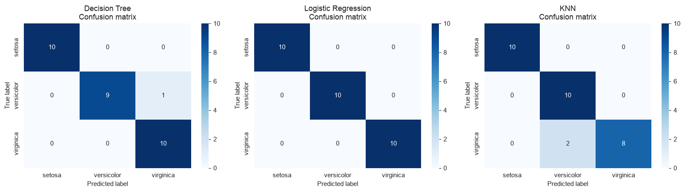

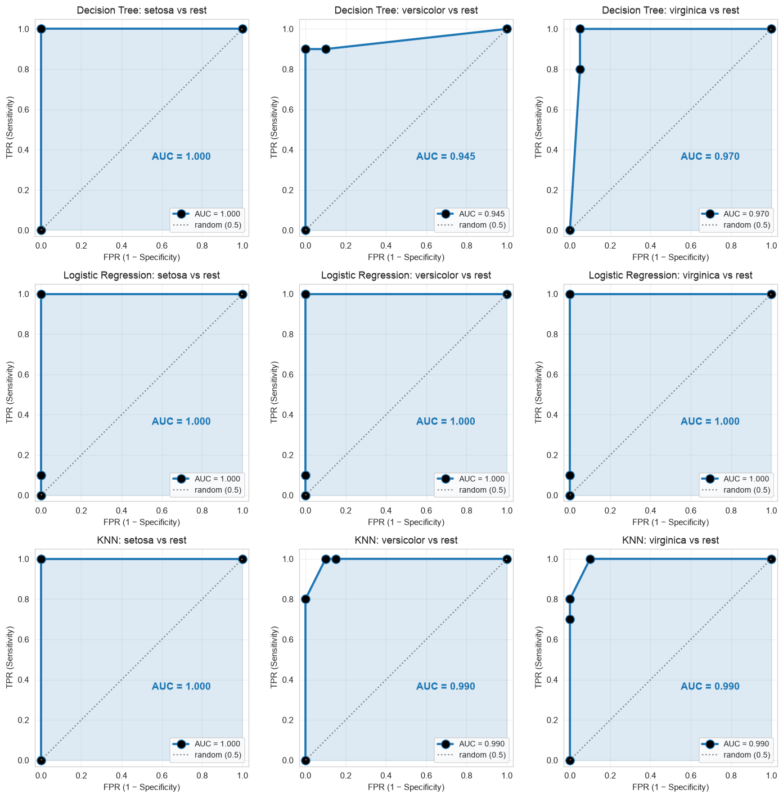

**Takeaways**
- *Setosa* is separated perfectly by every model; all errors are between *versicolor* and *virginica*.
- KNN has the lowest accuracy but a high AUC (0.993): its ranking is nearly perfect, it only misses on the decision threshold near the class boundary.
- The test set has just 30 samples (one error = 3.3 pp), so cross-validation is reported as the more reliable estimate. It confirms the ordering LR > DT > KNN.

## 2. Feature importance and hyperparameter sensitivity

### Feature importance

| Feature | Gini importance |
|---|---:|
| petal length | 0.559 |
| petal width | 0.406 |
| sepal width | 0.029 |
| sepal length | 0.006 |

<p align="center">
  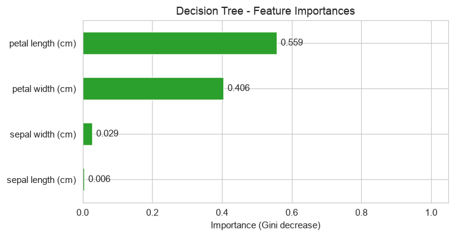
  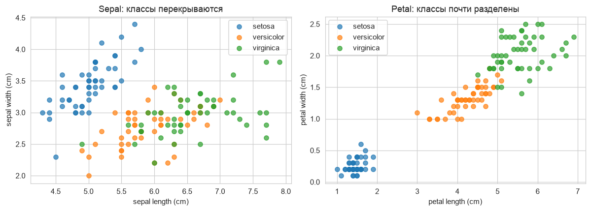
</p>

Petal measurements make the classes almost linearly separable, while sepal measurements overlap heavily.

### KNN: number of neighbours `k`

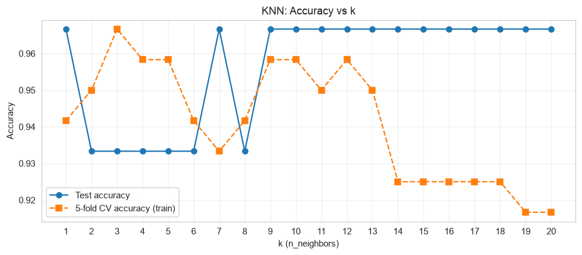

- `k = 1` memorises noise (CV 0.942).
- `k ≈ 3–12` is the stable optimum (CV 0.95–0.967, peak at `k = 3`).
- `k ≥ 14` over-smooths the boundary and CV drops to ~0.925.

### Decision Tree: `max_depth`

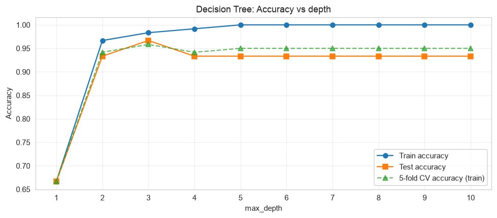

- `depth = 1` underfits (0.667 — only *setosa* is split off).
- `depth = 3` is the sweet spot: train 0.983, test 0.967, CV 0.958.
- `depth ≥ 5` reaches 100% train accuracy while test falls to 0.933 — classic overfitting.

## 3. Perceptron: ReLU vs Sigmoid vs Tanh

**Dataset:** Breast Cancer Wisconsin (569 samples, 30 features, 2 classes), split 60/20/20.
**Architecture:** `Linear(30 → 16) → activation → Linear(16 → 2)`, Adam (`lr=1e-3`, `weight_decay=1e-4`), batch 32, up to 300 epochs with early stopping (patience 20) on validation loss.

Everything except the activation function is identical across runs: data split, scaler, initialisation seed and mini-batch order.

| Activation | Test acc | Precision | Recall | F1 | Best epoch | Epochs run | Acc over 5 seeds | Epochs to val loss < 0.15 |
|---|---:|---:|---:|---:|---:|---:|---:|---:|
| ReLU | 0.974 | 0.970 | 0.974 | 0.972 | 175 | 195 | 0.960 ± 0.012 | 12.2 |
| Sigmoid | 0.947 | 0.938 | 0.953 | 0.945 | 297 | 300 | 0.947 ± 0.000 | 28.0 |
| **Tanh** | **0.974** | **0.970** | **0.974** | **0.972** | 213 | 233 | **0.972 ± 0.004** | **10.2** |

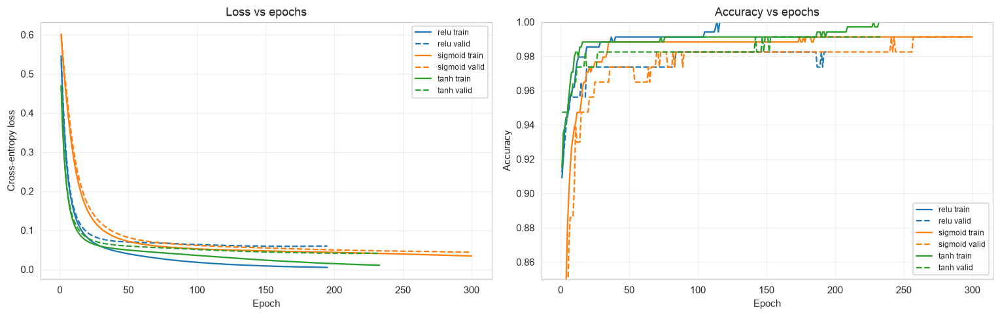

<p align="center">
  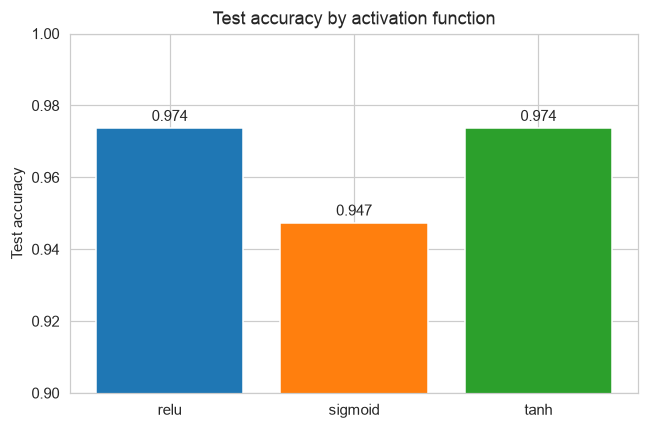
  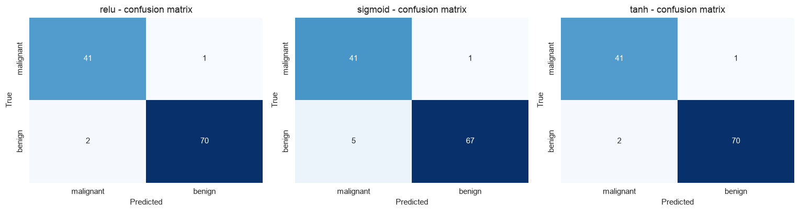
</p>

**Takeaways**
- **Tanh** converges fastest and is the most accurate and stable across seeds: zero-centred output and a derivative of 1 at the origin keep standardised inputs in the non-saturated region.
- **ReLU** matches Tanh on the main seed but varies more between seeds (dead units in a 16-neuron layer) and drives train loss lowest — a sign of mild overfitting.
- **Sigmoid** is the slowest learner (max derivative 0.25, non-centred output) and never triggered early stopping within 300 epochs.

## 4. MLP on MNIST: epochs and batch size

**Dataset:** 70,000 handwritten digits (28×28) — 54k train / 6k validation / 10k test.
**Architecture:** `784 → 256 → 128 → 64 → 10` with ReLU, Adam `lr=1e-3`. Nine runs from scratch over `epochs ∈ {5, 10, 20}` × `batch ∈ {32, 64, 128}`.

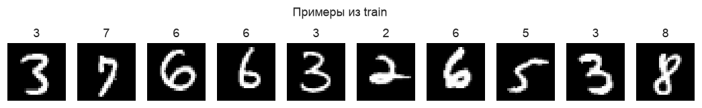

| Epochs | Batch | Train acc | Val acc | Min val loss | **Test acc** | Test loss | Time, s |
|---:|---:|---:|---:|---:|---:|---:|---:|
| 5 | 32 | 0.9864 | 0.9733 | 0.0883 | 0.9750 | 0.0939 | 11.1 |
| 10 | 32 | 0.9934 | 0.9747 | 0.0834 | **0.9797** | 0.0893 | 22.4 |
| 20 | 32 | 0.9966 | 0.9773 | 0.0834 | 0.9771 | 0.1255 | 45.4 |
| 5 | 64 | 0.9849 | 0.9717 | 0.0879 | 0.9761 | 0.0833 | 5.6 |
| 10 | 64 | 0.9943 | 0.9785 | 0.0834 | 0.9789 | 0.0882 | 11.7 |
| 20 | 64 | 0.9968 | 0.9773 | 0.0834 | 0.9793 | 0.1120 | 22.5 |
| 5 | 128 | 0.9824 | 0.9723 | 0.0895 | 0.9746 | 0.0776 | 3.1 |
| 10 | 128 | 0.9938 | 0.9755 | 0.0792 | 0.9774 | 0.0886 | 6.3 |
| 20 | 128 | 0.9982 | 0.9767 | 0.0792 | 0.9765 | 0.1192 | 14.0 |

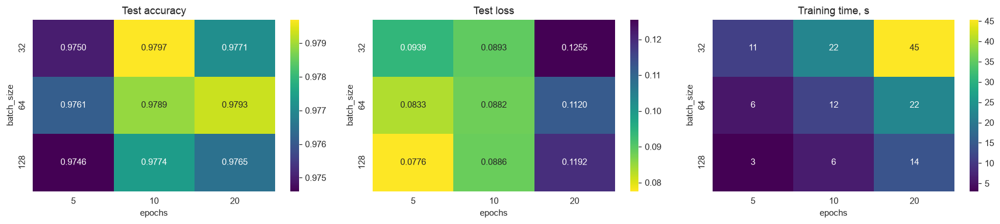

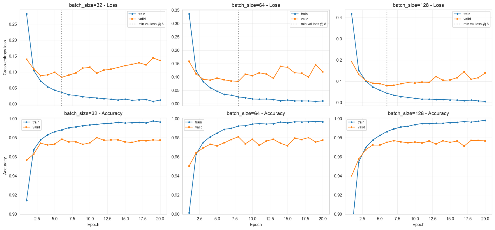

**Takeaways**
- **All nine configurations land within 97.5–98.0%** test accuracy — the grid matters far more for cost than for accuracy.
- **Epochs:** train loss keeps falling, but validation loss bottoms out within the first 10 epochs and then climbs. Going from 10 to 20 epochs raises test loss in every batch setting (e.g. 0.089 → 0.126 at batch 32) without improving accuracy — overfitting on confidence. Early stopping on validation loss is the right tool.
- **Batch size:** batch 128 trains **~3.2× faster** than batch 32 (14 s vs 45 s for 20 epochs) with smoother curves and essentially the same accuracy. The generalisation penalty of large batches does not show up in the 32–128 range.
- **Best trade-off:** batch 64–128 with ~10 epochs.

### Where the model goes wrong

<p align="center">
  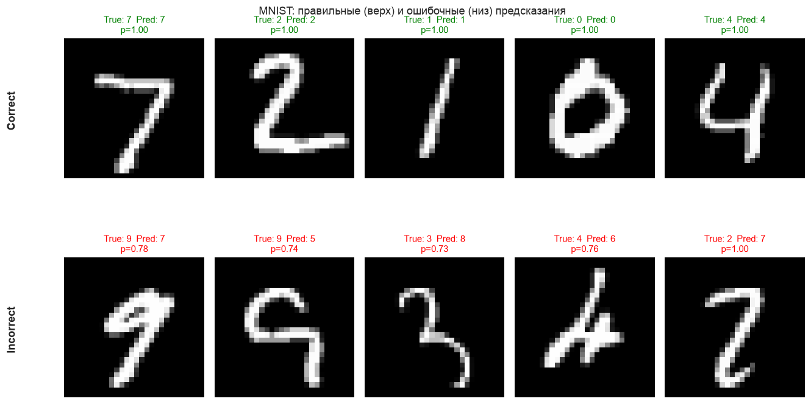
  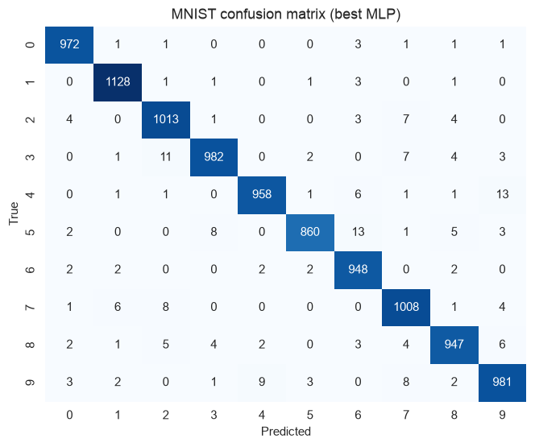
</p>

The most frequent confusions are **5→6 (13)**, **4→9 (13)** and **3→2 (11)** — visually similar shapes. Per-digit accuracy ranges from 96.4% (digit 5) to 99.4% (digit 1). A flattened MLP ignores spatial structure; a convolutional network would typically push MNIST above 99%.

---

## Reproducing the results

```bash
python -m venv .venv && source .venv/bin/activate
pip install -r requirements.txt
jupyter notebook Assignment_4_Baltabayev.ipynb
```

MNIST is downloaded automatically into `data/` on first run. Tabular metrics are written to `results/`:

```
results/
├── task1_metrics.csv     # classical classifiers on Iris
├── task3_metrics.csv     # perceptron activation comparison
├── task3_metrics.md
└── task4_results.csv     # MNIST epochs × batch-size grid
```

All runs use `RANDOM_STATE = 42`; the stability study in section 3 uses seeds 0–4. Timings were measured on CPU and will differ by machine.
